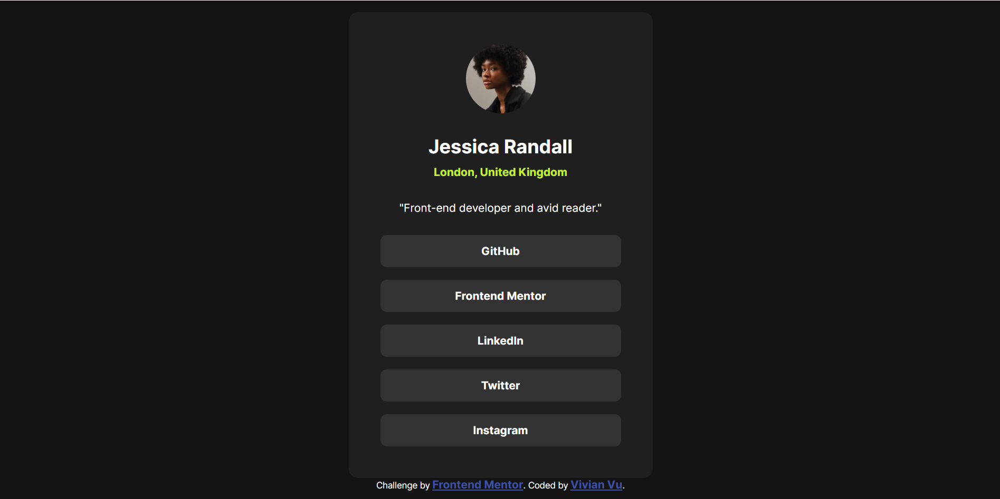

# Frontend Mentor - Social links profile solution

This is a solution to the [Social links profile challenge on Frontend Mentor](https://www.frontendmentor.io/challenges/social-links-profile-UG32l9m6dQ). Frontend Mentor challenges help you improve your coding skills by building realistic projects.

## Table of contents

- [Overview](#overview)
  - [The challenge](#the-challenge)
  - [Screenshot](#screenshot)
  - [Links](#links)
- [My process](#my-process)
  - [Built with](#built-with)
  - [What I learned](#what-i-learned)
  - [Continued development](#continued-development)
  - [AI Collaboration](#ai-collaboration)
- [Author](#author)

## Overview

### The challenge

Users should be able to:

- See hover and focus states for all interactive elements on the page

### Screenshot

### Links

- Solution URL: (https://github.com/viveevu11/social-links-profile)
- Live Site URL: (https://social-links-profile-kappa-two.vercel.app)

## My process

### Built with

- Semantic HTML5 markup
- CSS custom properties
- Flexbox
- Web-first workflow

### What I learned

I learned that adding a main tag is good for accessibility and identifies the pages primary content. I also learned that flex's justify-content and align-items do not center the text within them. Use text-align if you want the text centered. Gaps can look larger if the content around them has preset margins.

### Continued development

An area that I would like to continue to focus on on future projects is responsive layout and understanding padding.

### AI Collaboration

I used VS code's built in Copilot to help answer concepts I was confused about. It explained topics really well, so I was able to understand easily.

## Author

- Frontend Mentor - [@viveevu11](https://www.frontendmentor.io/profile/viveevu11)
